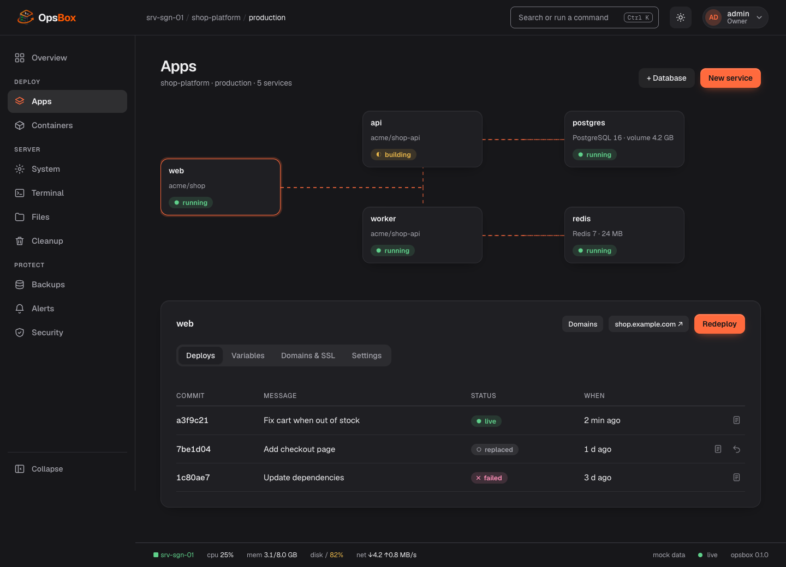

# opsbox

**Your own Railway / Render, on any Linux server.** Install once; deploy from GitHub, watch the machine, open a terminal, back up data, and manage the host from the browser. Goal: never SSH into the instance again.

> **Alpha.** APIs and UI can still change. Use it for side projects and staging first and keep backups off-box. Treat panel process compromise as host-root compromise; restrict panel access with a VPN, SSH tunnel, or IP allowlist. See [SECURITY.md](SECURITY.md) and [docs/THREAT_MODEL.md](docs/THREAT_MODEL.md).

The panel runs as `opsbox` but can request all typed operations from the root helper. Fixes 26/27 give the proxy a separate UID/socket and restrict its helper access to port-holder queries and `proxy:` secrets. Use trusted deployers only: fix 19 makes elevated Compose Admin-only, but this alpha is not a hostile-tenant sandbox. Full API tokens remain sensitive even though fix 20 excludes root-equivalent actions; ordinary deployments remain available.

Restrict Safe Mode separately: its root watchdog normally follows the panel's bind IP on port 8444. Fix 21 adds `[watchdog] allow_ips` for exact addresses checked before TLS; an empty/default list permits any source to reach recovery authentication. Restart `opsbox-watchdog` after changing it, include loopback explicitly for tunnels, and check exposure/fingerprint with `opsbox status`. `--local-only` makes the default recovery bind loopback unless `[watchdog] listen` overrides it. Existing hosts need these fixes installed and services restarted; only the latest alpha release receives security fixes.

## Supported OS

Primary targets (x86_64 and arm64, systemd):

- Ubuntu **22.04** and **24.04**
- Debian **12**

Other Linux distributions may work; they are not the alpha release bar yet.

Requirements (proposed, pending VM measurements): **1 GB to run apps, 2 GB or more to build on the server**. See the [server size guide](docs/INSTALL.md#server-size-guide) for proposed disk sizes and workload examples.

## Install

```sh
curl -fsSL https://github.com/khangdev20/opsbox/releases/latest/download/install.sh | sh
```

The installer prints a setup URL and a one-time claim token. Open the URL, create the admin account (2FA required), then attach a domain when ready. Re-running the installer upgrades in place and keeps data and configuration. Pass `--channel beta` for pre-releases or `--version vX.Y.Z` for a specific release. Signing and verification: [docs/RELEASING.md](docs/RELEASING.md).

Landing page: [site/](site/) (GitHub Pages).

## Screenshots

| Overview | Apps |
|---|---|
|  |  |

## Uninstall

```sh
sudo opsbox uninstall          # keep /var/lib/opsbox and /etc/opsbox (default)
sudo opsbox uninstall --purge  # also delete data and config (typed confirmation)
```

Or Settings → Export and uninstall → Uninstall opsbox (password + type `uninstall`). Apps keep running: managed containers switch to Docker restart policy `unless-stopped`. Proxy domains on 80/443 stop until another proxy takes over; an adopted web server (moved behind opsbox) is restored first. The audit log is written to `/var/lib/opsbox/uninstall-<date>.log` before removal. Re-running `install.sh` reuses kept data when present.

## Layout

- `web/` — the whole interface: plain HTML, CSS and ES modules, no build step. `web/js/api.js` selects real or sample data; each export maps to one REST endpoint (see `docs/API.md`).
- `web/vendor/monaco/` — the file editor (VS Code's editor core), self-hosted, loaded on first use.
- `crates/` — Rust workspace: server, privileged helper, auth, metrics, storage and shared protocol. The release binary embeds `web/`.
- `docs/ROADMAP.md` — what is built and what comes next.
- `docs/ARCHITECTURE.md` — the decisions; `docs/BACKEND_SPEC.md` — the full backend spec and implementation plan.

## Try the UI

`cd web && python3 serve.py` (caching off, so a normal reload shows edits), open http://localhost:8099. Demo 2FA code: any 6 digits. Setup token: `7QK2-9XMD-4TFA`.

## Principles

No telemetry, single static binary, UI embedded. Use `--local-only` for loopback access through an SSH tunnel, or restrict the panel with a VPN or IP allowlist. Review the separate Safe Mode listener and allowlist while alpha.

License: Apache-2.0. Bundled libraries and fonts retain their licences under `web/vendor` and `web/fonts`.
