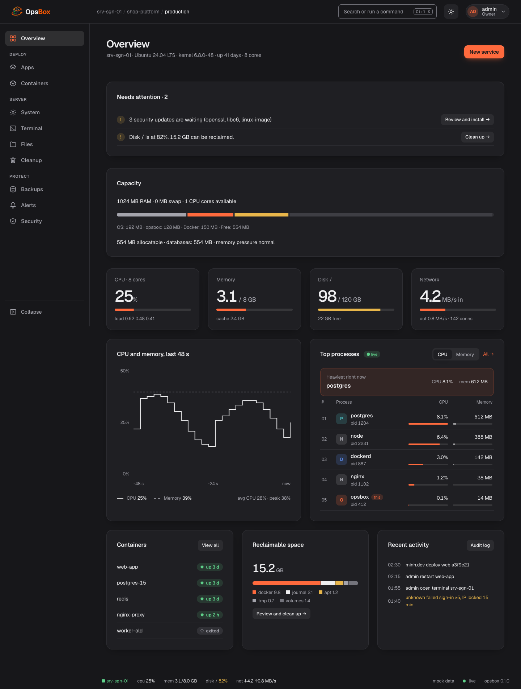

# opsbox

**Your own Railway / Render, on any Linux server.** Install once; deploy from GitHub, watch the machine, open a terminal, back up data, and manage the host from the browser. Goal: never SSH into the instance again.

> **Alpha.** APIs and UI can still change. Use it for side projects and staging first, keep backups off-box, and prefer a VPN, SSH tunnel, or IP allowlist for the panel. See [docs/SECURITY.md](docs/SECURITY.md) and [docs/THREAT_MODEL.md](docs/THREAT_MODEL.md).

## Supported OS

Primary targets (x86_64 and arm64, systemd):

- Ubuntu **22.04** and **24.04**
- Debian **12**

Other Linux distributions may work; they are not the alpha release bar yet.

## Install

```sh
curl -fsSL https://github.com/khangdev20/opsbox/releases/latest/download/install.sh | sh
```

The installer prints a setup URL and a one-time claim token. Open the URL, create the admin account (2FA required), then attach a domain when ready. Re-running the installer upgrades in place and keeps data and configuration. Pass `--channel beta` for pre-releases or `--version vX.Y.Z` for a specific release. Signing and verification: [docs/RELEASING.md](docs/RELEASING.md).

Landing page: [site/](site/) (GitHub Pages).

## Screenshots

| Overview | Apps |
|---|---|
|  |  |

## Uninstall

```sh
sudo opsbox uninstall          # keep /var/lib/opsbox and /etc/opsbox (default)
sudo opsbox uninstall --purge  # also delete data and config (typed confirmation)
```

Or Settings → Export and uninstall → Uninstall opsbox (password + type `uninstall`). Apps keep running: managed containers switch to Docker restart policy `unless-stopped`. Proxy domains on 80/443 stop until another proxy takes over; an adopted web server (moved behind opsbox) is restored first. The audit log is written to `/var/lib/opsbox/uninstall-<date>.log` before removal. Re-running `install.sh` reuses kept data when present.

## Layout

- `web/` — the whole interface: plain HTML, CSS and ES modules, no build step. `web/js/api.js` selects real or sample data; each export maps to one REST endpoint (see `docs/API.md`).
- `web/vendor/monaco/` — the file editor (VS Code's editor core), self-hosted, loaded on first use.
- `crates/` — Rust workspace: server, privileged helper, auth, metrics, storage and shared protocol. The release binary embeds `web/`.
- `docs/ROADMAP.md` — what is built and what comes next.
- `docs/ARCHITECTURE.md` — the decisions; `docs/BACKEND_SPEC.md` — the full backend spec and implementation plan.

## Try the UI

`cd web && python3 serve.py` (caching off, so a normal reload shows edits), open http://localhost:8099. Demo 2FA code: any 6 digits. Setup token: `7QK2-9XMD-4TFA`.

## Principles

Binds to localhost by default unless you open it for first-run claim, no telemetry, single static binary, UI embedded, panel meant to sit behind a VPN or IP allowlist while alpha.

License: Apache-2.0. Bundled libraries and fonts retain their licences under `web/vendor` and `web/fonts`.
